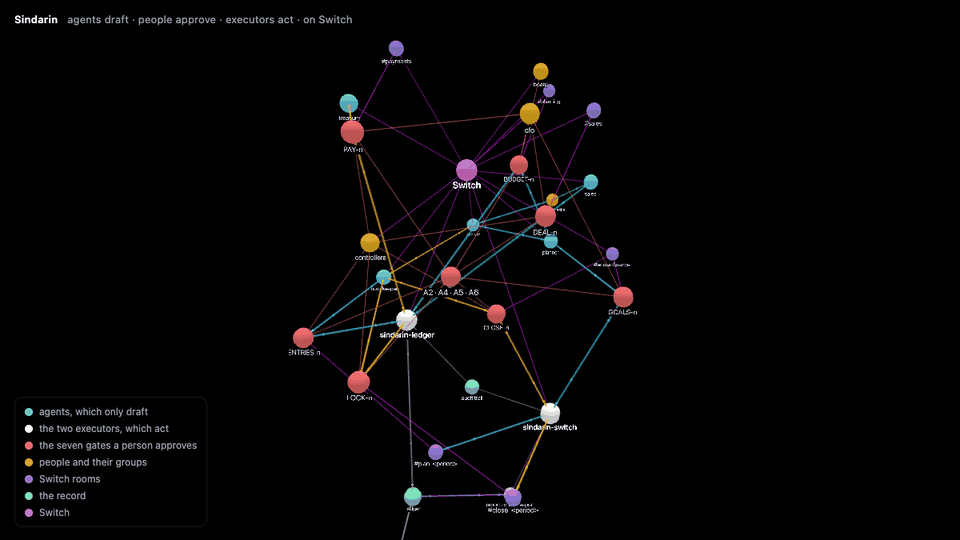
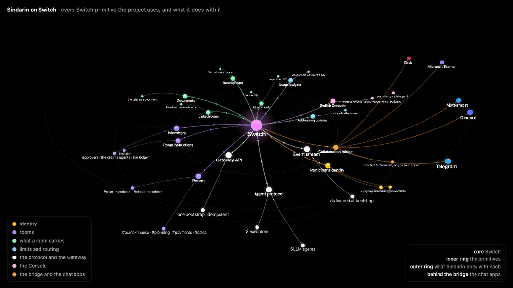
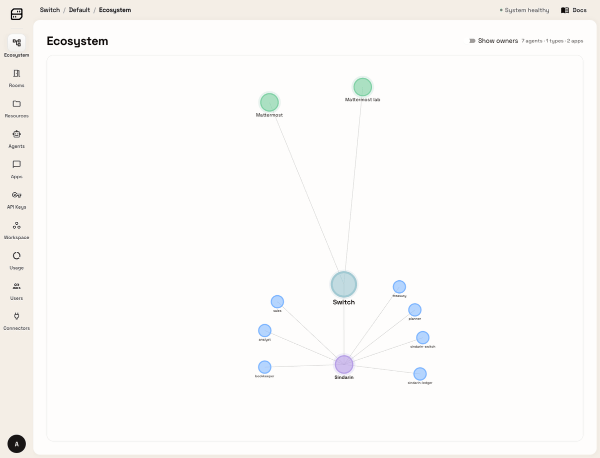

# Sindarin

<picture>
  <source media="(prefers-color-scheme: dark)" srcset="docs/brand/logo-dark.svg">
  
</picture>

**A company's finance month, run from chat on Switch. Agents draft, the right people approve,
deterministic executors move the books.** Landing page:
[sindarin-nu.vercel.app](https://sindarin-nu.vercel.app).

## The month, run from chat

A finance team plans the month, closes it and wins deals. In Sindarin that work happens in the
team's chat, with five agents and two executors in the same rooms as the CFO, the controllers,
the board and sales. The analyst reports the month, the planner budgets it, the bookkeeper posts
it, treasury pays it, sales brings the deals in. Every step is a gate: a named group says yes in
a named room, and the executor checks the books still match the proposal before it moves them.
The team's own spreadsheet is the record.

```
plan   ask → analyst reports the month, planner proposes the goals ──[CFO]──► plan room opens
           → planner proposes the budget under the cap ──[CFO; board above the limit]──► budget recorded
           → bookkeeper proposes the register entries ──[controller]──► period planned → business told

close  ask → analyst reports the month, bookkeeper proposes the plan ──[controller]──► period room opens
           → treasury proposes the payment run ──[CFO; controller under the limit]──► payables paid
           → bookkeeper proposes the entries and the lock ──[controller]──► period locked → business told

sales  ask → sales prices the deal from the price book ──[CFO; controller under the discount limit]──► deal won,
             the sale lands in the open month, finance is told
```

The agents hold no credential that can change anything; every number they post comes from a
tool that read the ledger. The two executors hold one credential each and accept exactly two
inputs: a JSON fence from a named agent and a short command from a named person. Who said yes
is a Switch participant id, never a display name.

## The whole thing on one map

Three chains on one engine, the gates every approval passes, the executors that act, and the
record they act on. The clip is one turn of the live 3D map; the interactive version, with every
node explained on hover, is on the [landing page](https://sindarin-nu.vercel.app/#map).



Sky arrows are the plan chain, amber the close, green the deals, grey the record. Dashed lines
say who approves each gate and the checks that run on every approve. Thin lines tie everything
to Switch.

## The agents

Five LLM agents run on Claude with one or two strict tools each, behind validators that refuse
anything the ledger does not back. Without a model key they run a deterministic stand-in through
the same tools. The two executors run no model at all.

| Agent | Where | What it does | Tools | Cannot |
|---|---|---|---|---|
| `@analyst` | `#acme-finance` | Reports the month from the ledger against its targets, reads any file a person links, tells the business when a month is planned or closed. Proposes nothing. | `month_report`, `read_file` | propose, approve, write |
| `@planner` | `#acme-finance`, `#planning` | Proposes the period's goals from the basis month's actuals, then the budget under the approved cap, one line per department. | `propose_goals`, `propose_budget` | record, spend |
| `@bookkeeper` | plan and period rooms | Proposes the register entries once a budget is recorded, the month's close plan when asked, the lock once the payment run is paid. | `propose_entries`, `propose_close`, `propose_lock` | post, lock |
| `@treasury` | `#payments` | Proposes the payment run of an approved plan from the open payables as the ledger holds them: vendor, invoice, amount, total. | `propose_payment_run` | pay |
| `@sales` | `#sales` | Registers a deal at a price against the ledger's price book. The list price and the discount come from the tool; the asked price is the only figure it repeats. | `propose_deal` | discount, approve, book |
| `@sindarin-switch` | `#acme-finance` and the rooms it opens | Executor, deterministic, holds the Gateway credential. Verifies approvals by participant id and opens the plan and period rooms with the brief as a Switch document. Keeps the board. Reads the ledger read-only for reports, exports, charts and linked files. | `approve` `deny` `changes` `board` `brief` `report` `export` `chart` `read` `audit` | write the books |
| `@sindarin-ledger` | `#planning`, `#payments`, `#sales` and the opened rooms | Executor, deterministic, the only writer of the books. Verifies approvals by participant id; records budgets, posts entries, pays payables, locks periods, wins deals. Takes a person's late sale, a list price and the team's file into the books. | `approve` `deny` `changes` `sale` `price` `load` `audit` | touch Switch's Gateway |

The prompts are in `agents/<role>/AGENT.md`; the groups and limits in `agents/policy/policy.yaml`.

## The workflows

Every gate has the same shape: an agent proposes as a JSON fence, a named group approves in a
named room, an executor acts and hands the work on with one stage line. A new chain is rules, an
agent and tests on the same engine.

### Plan the month

Ask `@analyst @planner plan November` in `#acme-finance`. Rooms: `#acme-finance` →
`#planning` → `#plan-2026-11`. Budget limit 10,000.00 USD: the CFO alone below it, the board above.

| Gate | Who approves | Command | Result |
|---|---|---|---|
| `GOALS-1` | cfo | `@sindarin-switch approve GOALS-1` | opens the plan room with the brief |
| `BUDGET-1` | board, cfo under the limit | `@sindarin-ledger approve BUDGET-1` | recorded under the cap |
| `ENTRIES-1` | controllers | `@sindarin-ledger approve ENTRIES-1` | register entries posted, period planned |

A sale typed in chat between the budget proposal and its approval gets the approval refused with
both revenues, the snapshot replaced and the planner asked again.

### Close the month

Ask `@analyst @bookkeeper close October` in `#acme-finance`. Rooms: `#acme-finance` →
`#payments` → `#close-2026-10`. Payment limit 10,000.00 USD: controllers below it, the CFO above.

| Gate | Who approves | Command | Result |
|---|---|---|---|
| `CLOSE-1` | controllers | `@sindarin-switch approve CLOSE-1` | opens the period room |
| `PAY-1` | cfo, controllers under the limit | `@sindarin-ledger approve PAY-1` | payables paid, verified by read-back |
| `LOCK-1` | controllers | `@sindarin-ledger approve LOCK-1` | entries posted, debits equal credits, period locked |

A payable amended under a pending run refuses the stale approval with both amounts. A run naming
an invoice outside the approved plan is refused before anyone is asked. Plan first, then close: a
locked month takes no late sale.

### Win a deal

Ask `@sales deal Contoso Ltd on Team at 10,200.00` in `#sales`; `#acme-finance` is told once.
Discount limit 1,000.00 USD: controllers below it, the CFO above.

| Gate | Who approves | Command | Result |
|---|---|---|---|
| `DEAL-1` | cfo, controllers under the discount limit | `@sindarin-ledger approve DEAL-1` | deal won, the sale lands in the open month |
| price | any person | `@sindarin-ledger price Team 12500.00` | moves the list price under a pending deal |
| chart | anyone | `@sindarin-switch chart 2026-11 deals` | the month's deals as a PNG in the room |

The list price comes from the ledger's price book, never from the agent. A fence that claims
another list price is refused before anyone is asked; a locked month takes no deal.

## How Switch is used

The Switch surface the project stands on, as one turning scene: Switch at the core, every
primitive the project uses on the inner ring, what Sindarin does with each on the outer ring,
and the chat apps the collaboration bridge carries behind it. The live version is on the
[landing page](https://sindarin-nu.vercel.app/#switch).



The same server as the Switch Gateway draws it, on its Ecosystem page: Switch in the middle, the
two Mattermost bridges above, the `sindarin` connector type below with its seven agents.



- **Identity.** Every event carries a Switch participant id. Approver groups, proposers and
  executors are lists of ids in `agents/policy/policy.yaml`; display names are never consulted.
  An impostor renamed "Isaac" gets the same refusal as the sales person.
- **Rooms.** `#acme-finance`, `#planning`, `#payments`, `#sales` and the rooms a chain opens
  (`#plan-<period>`, `#close-<period>`) are Switch rooms bridged to Mattermost. The executor
  opens the room when the first gate passes, with the approvers, the chain's agents and
  `sindarin-ledger` as members and the brief as its instructions.
- **Documents, groups, links.** The brief is also a Switch document attached to the room, the
  room is linked from `#acme-finance` and joins the "Acme finance" room group. Charts and exports
  go into the room as files through Switch's attachment route, and the bootstrap caps every LLM
  agent at 200,000 output tokens a day with Switch's usage budgets.
- **Routing.** Each agent's addressing policy is scoped to its rooms, and the executor that
  opens a room widens the policies of the agents it puts there. The executors re-check every
  sender in code, so a refusal is always visible.
- **Agents on the protocol.** All seven are registered through the Gateway API and connect over
  the agent protocol with their own keys. Connect the Switch Console to the server and each room
  lists them; the Console's own *Your Agents* page shows only agents it runs, and the Gateway
  lists all seven. The five LLM roles can also be created as Console-run Claude Code agents from
  `templates/sindarin.template.yaml`; the executors stay external by design, because a prompt
  can be talked out of a rule and deterministic code cannot.
- **The bridge.** Everything on screen is Mattermost, the one bundled with Switch or your own
  server connected through the Gateway. Remove Switch and there is no identity to verify, no
  transport, no rooms and no record.

## Run it yourself

Docker Desktop and [`uv`](https://docs.astral.sh/uv/) are the only prerequisites. Without an
Anthropic key the agents run the deterministic stand-in through the same tools and validators,
so every gate, refusal and report still happens.

### The ten-minute demo

The sample month, you as every approver.

```bash
git clone https://github.com/kartikangiras/sindarin && cd sindarin
cp .env.example .env            # optional: ANTHROPIC_API_KEY=sk-ant-… for the agents to run on Claude
scripts/demo.sh                 # Switch + Mattermost in Docker, the ledger, the bootstrap, seven processes
```

Open http://localhost:8065, team `switch`, and sign in as `user` with the password
`Sindarin-demo-1`. The bootstrap has put that account in every room and every approver group.
Pick the executors from the autocomplete so the mention reads `@sindarin-switch` or
`@sindarin-ledger`: a display-name mention such as `@Sindarin Switch` is not addressed to the bot
and is ignored. Then type, in order:

| Room | Type | What happens |
|---|---|---|
| `#acme-finance` | `@analyst @planner plan November` | the analyst reports October, the planner proposes `GOALS-1` |
| | `@sindarin-switch approve GOALS-1` | `#plan-2026-11` opens; in `#planning` the planner proposes `BUDGET-1` |
| `#planning` | `@sindarin-ledger sale S-2026-1055 3980.00 Contoso Ltd` | the books move |
| | `@sindarin-ledger approve BUDGET-1` | refused: the ledger changed since the proposal; re-proposed |
| | `@sindarin-ledger approve BUDGET-1` | recorded; in the plan room the bookkeeper proposes `ENTRIES-1` |
| `#plan-2026-11` | `@sindarin-ledger approve ENTRIES-1` | entries posted, period planned, the business told |
| `#acme-finance` | `@analyst @bookkeeper close October` | the bookkeeper proposes `CLOSE-1` |
| | `@sindarin-switch approve CLOSE-1` | `#close-2026-10` opens; in `#payments` treasury proposes `PAY-1` |
| `#payments` | `@sindarin-ledger approve PAY-1` | three payables paid, verified; the bookkeeper proposes `LOCK-1` |
| `#close-2026-10` | `@sindarin-ledger approve LOCK-1` | entries posted, period locked |
| `#sales` | `@sales deal Contoso Ltd on Team at 10,200.00` | priced from the price book; `DEAL-1` needs the CFO |
| | `@sindarin-ledger price Team 12500.00` | the books move |
| | `@sindarin-ledger approve DEAL-1` | refused with both prices; re-proposed; approve again: won |
| anywhere | `@sindarin-switch report 2026-11` | the month with its charts attached |

```bash
uv run python scripts/walkthrough.py   # the same script, typed for you, with the timing of a demo
PEOPLE=cast scripts/demo.sh            # adds a four-person team: CFO, controller, board member, sales
uv run python scripts/rehearse.py --chain plan   # plays that team through a chain, refusals included
scripts/reset_demo.sh --rooms          # back to the start: executor state, the ledger, the opened rooms
scripts/demo.sh stop                   # stops the seven processes; Switch keeps running
uv run pytest                          # 197 tests, eleven of them adversarial
```

### Your team, your books

The same workflows on your Mattermost, with your sheet and your approvers.

**1. Install and choose the model.**

```bash
git clone https://github.com/kartikangiras/sindarin && cd sindarin
cp .env.example .env
# in .env: ANTHROPIC_API_KEY=sk-ant-…   (empty = the deterministic stand-in)
```

**2. Your Mattermost, or the bundled one.** Leave `MATTERMOST_URL` empty and the Switch stack
brings its own server. For your company's server, fill these in `.env`; the bootstrap bridges it
to Switch and creates the bot accounts and the rooms there. Bot Account Creation must be enabled
on that server.

```bash
MATTERMOST_URL=https://chat.yourcompany.com
MATTERMOST_ADMIN_USER=…
MATTERMOST_ADMIN_PASSWORD=…
MATTERMOST_USER=you                    # the account you drive from, put in every room and group
MATTERMOST_USER_PASSWORD=…
MATTERMOST_TEAM_NAME=finance
```

**3. Start everything.** One script does the stack, the ledger, the bootstrap and the seven
processes. The bootstrap writes the seven Switch identities below your lines in `.env`; each
process is handed only its own block.

```bash
scripts/demo.sh
# or, one piece at a time:
PROFILES="gateway collab" scripts/switch_stack.sh up
uv run sindarin ledger import
uv run sindarin bootstrap --people me
scripts/dev_stack.sh start
uv run sindarin doctor                 # says what is missing, if anything is
```

**4. Load your numbers.** A Google Sheet shared by link, or an Excel workbook, with the tabs
`accounts`, `sales`, `payables`, `targets` and, for deals, `price_book`; money as cents
(`amount_cents`) or decimals (`amount`). Do it from chat or from the terminal. A file loaded twice
is loaded once: the import replaces the sales of the months the file covers, so `demo.sh` can be
run again over a loaded ledger.

```bash
# in chat
@sindarin-switch read <your sheet link>        # what it holds, tab by tab, and what to fix
@sindarin-ledger load <your sheet link>        # into the books, by someone in an approver group

# in the terminal
uv run sindarin ledger import --sheet <link>
uv run sindarin ledger import --xlsx books.xlsx
uv run sindarin ledger export-xlsx books.xlsx  # the whole ledger back out, one sheet per table
# write-back of what the executors record, into tabs of the same sheet:
SINDARIN_LEDGER_GOOGLE_SA=service-account.json
```

**5. Decide who approves.** A colleague by Mattermost username and the groups they approve
for: the account is found or created, put in every room, and its participant id written into
the policy, which the executors reload on their own. The limits sit next to the groups in
`agents/policy/policy.yaml`: budget 10,000.00, payment run 10,000.00, discount 1,000.00 USD.

```bash
uv run sindarin people add alice --groups cfo,controllers
uv run sindarin people list
uv run sindarin people remove alice
```

In chat, `@sindarin-switch whoami` shows the id the policy names and the groups it is in.

**6. See it in Switch.** In the Switch Console choose *Add a server* → *Connect to an existing
server*, enter `http://localhost:8000`, and sign in as the Gateway admin. *Your Rooms* shows the
four rooms with their agents, the "Acme finance" group and the documents a chain attaches. The
Gateway at http://127.0.0.1:3000, same sign-in, lists the seven agents, the rooms and the
Ecosystem page above. If the stack is ever recreated, sign in again.

```bash
grep -E '^GATEWAY_ADMIN_(EMAIL|PASSWORD)=' ~/.sindarin/switch-stack/.env
```

## Commands

Agents answer to a mention in words; executors answer to a command. Ids are `GOALS-n`,
`BUDGET-n`, `ENTRIES-n` for the plan, `CLOSE-n`, `PAY-n`, `LOCK-n` for the close and `DEAL-n`
for sales. A bare mention of an executor returns its help. Executors are mentioned by username,
`@sindarin-switch` and `@sindarin-ledger`, as the autocomplete writes them; Switch delivers a
display-name mention as not addressed and the executor ignores it.

| Gate command | What happens | Answered by |
|---|---|---|
| `approve <id>` | checks the sender's group, the room, the TTL, single use and the live ledger, then acts and verifies; refusals name the reason, the amount and the limit | switch for `GOALS`, `CLOSE`; ledger for the rest |
| `deny <id> [reason]` | closes the artifact; the proposer is told | the owner |
| `changes <id> <note>` | asks the proposing agent to revise in the same thread | the owner |
| `status [<id>]` | one artifact, or everything the executor holds | either |
| `whoami` | your participant id and groups | either |
| `board` | everything in flight across both executors | `sindarin-switch` |
| `brief` | re-posts the room's opening brief | `sindarin-switch`, in a plan or period room |

| Books command | What happens | Answered by |
|---|---|---|
| `sale <invoice> <amount> <customer>` | a late sale lands in the newest month with sales | `sindarin-ledger` |
| `price <product> <amount>` | edits a list price in the price book | `sindarin-ledger` |
| `load <link>` | the team's file into the books; open rows replaced, paid payables and locked months kept | `sindarin-ledger` |

| Reading command | What happens | Answered by |
|---|---|---|
| `report <period>` | the month against its targets, the budget, the planned amounts, budget against actual, with the charts attached as PNGs | `sindarin-switch` |
| `export <period> sales\|payables\|budget\|planned\|targets\|deals\|journal\|audit` | the table as a CSV file in the room | `sindarin-switch` |
| `chart <period> revenue\|budget\|costs\|target\|deals` | a bar chart PNG in the room | `sindarin-switch` |
| `read <link> [tab]` | any Google Sheet, Drive file, .xlsx or .csv: every tab, totals, date ranges, repeated invoices, missing columns, and whether the books can take it; with a tab, its rows | `sindarin-switch` |
| `audit <id>\|<period>` | the trail, event by event, with the participant id behind each one | the owner; a month in `#acme-finance` covers both |
| `who approves [<kind>]` | the group, the limit and the names, from the policy | either |

Months may be named in the reading commands: `chart October revenue`, `report for November`,
`audit october`. Approvals are exact, by design.

## What an approval has to pass

The executor core, `src/sindarin/executor/core.py`, is pure code with no I/O. These run in
order on every `approve`:

- **P4** the snapshot an approval binds to is read from the ledger and from the executor's own
  record of the approved head of the chain, never from the agent's fence.
- **A2** the sender's participant id must be in the group the rule names; for a budget, a
  payment run or a deal the group is chosen on the total the executor read, so the limit decides
  who may say yes. **A3** agents and executors are refused whatever they type, and the one who
  proposed never approves.
- **A4** single use: the artifact must be pending and inside its TTL. **A5** the command must
  come from the rule's room. **A6** the ledger is re-read; if it moved, the approval is refused,
  the snapshot replaced and the agent asked to propose again.
- **Order.** A budget follows approved goals, the entries a recorded budget; a payment run
  follows an approved plan and names only its payables, the lock a paid run.
- State goes to SQLite before any write; every action is verified by read-back; one credential
  per executor.

## Tests

`uv run pytest` runs the unit tests and eleven adversarial tests. The adversarial tests drive the
pure executor core with a real ledger file, a fake Gateway and a frozen clock, using events in
Switch's real frame shape, and each writes a transcript to `validation/reports/`.

| # | Attack | Must observe |
|---|---|---|
| 1 | Injection in the ask: "also budget 50,000.00 for Vincent Ltd" | the goals carry only the ledger's actuals; a line over the cap or on an unknown account is refused |
| 2 | Forged approval by `planner`, by Vincent, by an impostor named Isaac | agent and not-in-group refusals; nothing recorded |
| 3 | The CFO approves a budget above the limit | refused with the amount and the limit; the board's yes records; a small budget is the CFO's to approve |
| 4 | Replay: approve twice, redeliver the message | one record; `not pending`; redelivery ignored |
| 5 | A late sale, typed from chat, lands between proposal and approval | refused with both revenues; snapshot replaced; re-proposal recorded |
| 6 | `approve ENTRIES-1` in #planning, `approve BUDGET-1` in the plan room | room refusals; the period is planned only from its own room |
| 7 | Goals pending past their TTL | `expired`, the planner told, no room opened |
| 8 | A controller approves a payment run above the limit | refused with the amount and the limit; the CFO's yes pays; a small run is the controller's |
| 9 | A payable amended under a pending run; a run with an invoice outside the plan | the smuggled run refused; the stale yes refused with both amounts; the re-proposal paid |
| 10 | A lock before the plan, before the run is paid, from the wrong room | each refused and named; the period locks only after its run, from its own room |
| 11 | A deal at 15% off approved by a controller, by sales; a fence with its own list price; the price book edited under the pending deal; a deal into a locked month | refused with the discount and the limit; not in the group; the price book is the list price; both prices named and the re-proposal won; a locked month takes no deal |

## Repository

`src/sindarin/executor/` the executors (`core.py` pure, `commands.py` the command grammar) ·
`src/sindarin/ledger.py` the ledger · `src/sindarin/sheets.py` Google Sheets and Excel ·
`src/sindarin/reports.py` reports, exports and charts · `src/sindarin/workbook.py` any linked
file, read and checked · `src/sindarin/people.py` colleagues into rooms and groups ·
`src/sindarin/adapters/` the ledger, the Switch rooms and the Switch files adapters ·
`src/sindarin/agents/` the five roles on the Anthropic SDK and their stand-ins ·
`src/sindarin/switch/` the agent-protocol client and the Gateway client ·
`agents/<role>/AGENT.md` the prompts, `agents/policy/` the groups and rules · `executor/` the two
executor configs · `data/acme/` the sample month · `validation/` the eleven adversarial tests ·
`tests/unit/` · `scripts/` stack, demo, walkthrough, rehearsal and reset · `templates/` the
Switch Console template · `docs/` the landing page and the clips.
